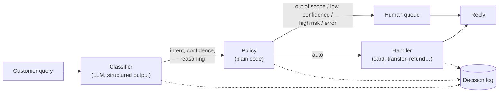

# Switchboard: a config-driven LLM intent router

A customer message comes in, an LLM classifies it into one of a fixed set of intents, a
plain-code policy layer decides whether it is safe to automate, and a dispatcher runs the
matching workflow or escalates to a human with the reason why.

The reference domain is retail-banking support, built on the
[Banking77](https://huggingface.co/datasets/PolyAI/banking77) dataset. Everything
domain-specific (intents, descriptions, examples, handlers, risk levels, policy
thresholds, model settings) lives in one YAML file. The engine is generic, and so is the
LLM: providers sit behind a small interface. An Anthropic provider and an offline mock
are included.



## See it in action

You send a query with a single command. Switchboard then classifies it, applies the
policy, and runs the matching workflow.

### The command

```bash
switchboard route "<customer query>" [--customer ID] [--config PATH] [--json]
```

| Argument | Required | What it does |
|---|---|---|
| `"<customer query>"` | yes | The customer's message, in quotes (1–2,000 characters) |
| `--customer ID` | no | Which customer the request is from. Handlers use it to look up the account. Demo ids are `cust_001` and `cust_002`. Default: `SWITCHBOARD_DEFAULT_CUSTOMER`, or `anonymous` if that isn't set |
| `--config PATH` | no | Which domain config to route with. Default: `configs/banking.yaml` |
| `--json` | no | Print the full result as JSON instead of the readable summary |

Which LLM is used comes from the environment, not the command line. Set
`SWITCHBOARD_PROVIDER=anthropic` to use a real model, or leave it unset for the offline
mock. `SWITCHBOARD_MODEL` and the other `SWITCHBOARD_*` variables in
[.env.example](.env.example) override the model settings.

### Example

```bash
switchboard route "my card hasn't arrived" --customer cust_001
```

```text
intent      card_arrival (high)  secondary: -
reasoning   Customer says their card has not arrived, matching card_arrival.
decision    auto -> card_delivery_status  reasons: -
status      ok
reply       Your card was shipped via Royal Mail and should arrive by 2026-10-30.
trace       c5e9fae7e0b7424fb1f0838e9e83dea5  model=claude-haiku-5-5 prompt=2dbfad9e 1273 ms
```

**Reading the output:**

| Line | Meaning |
|---|---|
| `intent` | The intent the LLM chose, with its confidence (`low` / `medium` / `high`) and any secondary intents |
| `reasoning` | The LLM's one-sentence explanation of the choice |
| `decision` | What the policy decided. `auto` runs the intent's handler; `human` sends the request to the human queue and lists the reasons |
| `status` | What the handler did: `ok` (the workflow ran), `not_found` (nothing to act on), or `queued` (handed to a person) |
| `reply` | The message the customer gets back |
| `trace` | A unique id that links this request to its decision-log line and any human-queue ticket, plus the model, prompt version and latency |

### More examples

| Customer query | Classified as | Decision | Customer gets |
|---|---|---|---|
| "Why was I charged a fee for paying by card abroad?" | `card_payment_fee_charged` (high) | **auto** → `fee_explanation` | "The 1.20 GBP fee on 2026-10-26 at Café de Flore was a foreign currency card payment (2.0% fee outside the free allowance)." |
| "I think someone stole my card" | `lost_or_stolen_card` (high) | **human**, reason `high_risk` | "Thanks, a specialist will review your request and get back to you shortly." |
| "I sent money to the wrong person, can I stop it?" | `cancel_transfer` (high) | **human**, reason `high_risk` | Same holding message, plus a ticket in the human queue |
| "What's the exchange rate for euros today?" | `out_of_scope` (high) | **human**, reason `out_of_scope` | Same holding message, plus a ticket in the human queue |

High-risk intents (lost or stolen card, compromised card, cancelling a transfer) always
go to a person, even when the model is confident. Automated replies come from mock
handlers that read a [fake customer account](data/fixtures/accounts.json).

All examples are real runs against `claude-haiku-5-5` with the demo customer `cust_001`.

### Evaluating instead of routing

`switchboard eval` runs the classifier over a labeled set and writes a report (see
[Results](#results)):

```bash
switchboard eval [--limit N] [--workers N] [--data PATH] [--config PATH] [--out-dir DIR]
```

| Argument | Default | What it does |
|---|---|---|
| `--limit N` | all rows | Only evaluate the first N rows (the set is shuffled, so this is a fair sample) |
| `--workers N` | 4 | How many queries to classify in parallel |
| `--data PATH` | `data/eval/banking77_eval.jsonl` | The labeled eval set |
| `--config PATH` | `configs/banking.yaml` | The domain config to evaluate |
| `--out-dir DIR` | `reports` | Where to write the report and the raw predictions |

### Every request is logged

Each request writes one line to `logs/decisions.jsonl`. The raw query is left out by
default, because it may contain personal data:

```json
{"trace_id": "8131e127…", "prompt_version": "2dbfad9e", "model": "claude-haiku-5-5",
 "intent": "lost_or_stolen_card", "confidence": "high", "action": "human",
 "reasons": ["high_risk"], "status": "queued", "latency_ms": 911.65,
 "input_tokens": 1714, "output_tokens": 67, ...}
```

Each escalation also creates a ticket in `logs/human_queue.jsonl`. The ticket includes
the query text, because a reviewer needs to read it.

## Results

Evaluated on 420 held-out queries from the Banking77 **test** split:

- **320 in scope:** 40 for each of 8 intents.
- **100 out of scope:** half of them are deliberate near misses (e.g. `pin_blocked`,
  `card_delivery_estimate`), the other half are random other intents.

The few-shot examples come from the **train** split, so the two don't overlap.

| Metric | Value |
|---|---|
| Accuracy | **90.0%** |
| Macro F1 | **0.918** |
| Classifier errors | 0 / 420 |
| Latency mean / p95 | 1.2 s / 1.9 s |
| Cost per 1,000 queries | **$0.21** |

**Confidence is well calibrated, and the policy threshold is based on it:**

| Model confidence | Share of queries | Accuracy |
|---|---:|---:|
| high | 67% | 97.9% |
| medium | 30% | 76.0% |
| low | 4% | 60.0% |

| Policy `min_confidence` | Automated | Wrong among automated |
|---|---:|---:|
| medium | 52% | 11.8% |
| **high** (chosen) | 42% | **2.3%** |

For a bank, precision matters more than coverage, so the default threshold is `high`.

**Where it struggles:** out-of-scope recall is 67%. Most of the misses are near-miss
intents that look like supported ones, such as "How do I unblock my PIN?" being routed
to `change_pin`. Some are arguably label noise in Banking77.

Setup: `claude-haiku-5-5`, prompt `2dbfad9e`, effort `low`, thinking off.
Reproduce with `switchboard eval`.

## Run it yourself

### 1. Install

You need [uv](https://docs.astral.sh/uv/) and Python 3.11+. uv installs Python for you
if it's missing.

```bash
git clone https://github.com/amankumarcode/switchboard.git
cd switchboard
uv sync
```

### 2. Try it offline (no API key)

By default Switchboard uses a deterministic **mock provider** that matches words against
the config's examples. It's good enough to run every part of the pipeline:

```bash
uv run switchboard route "I want to change my PIN" --customer cust_001
uv run switchboard route "My card was stolen" --customer cust_001 --json
```

### 3. Run it with a real LLM

The included provider uses the Anthropic API:

```bash
cp .env.example .env
# edit .env: set ANTHROPIC_API_KEY=... and SWITCHBOARD_PROVIDER=anthropic
uv run --env-file .env switchboard route "my card hasn't arrived" --customer cust_001
```

Demo customers are `cust_001` (has a shipped card order, a pending transfer, a pending
refund and a foreign-card fee) and `cust_002` (a mostly empty account). Set
`SWITCHBOARD_DEFAULT_CUSTOMER=cust_001` in `.env` to skip the `--customer` flag.

### 4. Run the eval

```bash
uv run --env-file .env switchboard eval            # full 420 rows, about $0.09
uv run switchboard eval --limit 50                 # offline, on the mock provider
```

The report is written to `reports/eval-<model>-<prompt_version>.md`. It covers accuracy,
macro F1, per-intent scores, the confusion matrix, accuracy by confidence, the routing
outcome, the near misses that were wrongly accepted, latency and cost. The raw
predictions are written next to it.

### 5. Run the tests

```bash
uv run pytest            # about 100 tests, all offline
uv run ruff check
```

## Data and credits

- **Banking77**: Casanueva et al., *Efficient Intent Detection with Dual Sentence
  Encoders* (2020). [PolyAI/banking77](https://huggingface.co/datasets/PolyAI/banking77),
  licensed under [CC BY 4.0](https://creativecommons.org/licenses/by/4.0/). The eval set
  in `data/eval/` is a sample of its test split; the few-shot examples in the config come
  from its train split.

## License

The code is released under the [MIT License](LICENSE). The dataset keeps its own license
(see above).
