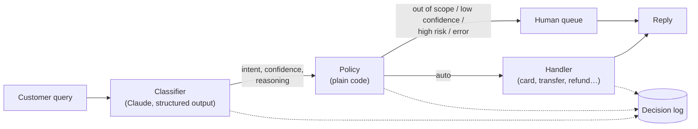

# Switchboard

**A config-driven LLM intent router.** A customer message comes in, Claude classifies it
into one of a fixed set of intents, a plain-code policy layer decides whether it is safe
to automate, and a dispatcher runs the matching workflow or escalates to a human with the
reason why.

The reference domain is retail-banking support, built on the
[Banking77](https://huggingface.co/datasets/PolyAI/banking77) dataset. Everything
domain-specific (intents, descriptions, examples, handlers, risk levels, policy
thresholds, model settings) lives in one YAML file. The engine is generic.



## See it in action

These are real runs against `claude-haiku-5-5` using the demo customer `cust_001` from
[the fixture data](data/fixtures/accounts.json).

**A routine request is handled automatically.** The handler looks up the card order:

```text
$ switchboard route "my card hasn't arrived" --customer cust_001
intent      card_arrival (high)  secondary: -
reasoning   Customer says their card has not arrived, matching card_arrival.
decision    auto -> card_delivery_status  reasons: -
status      ok
reply       Your card was shipped via Royal Mail and should arrive by 2026-10-30.
trace       c5e9fae7e0b7424fb1f0838e9e83dea5  model=claude-haiku-5-5 prompt=2dbfad9e 1273 ms
```

**Another routine request.** The handler explains the actual fee on the account:

```text
$ switchboard route "Why was I charged a fee for paying by card abroad?" --customer cust_001
intent      card_payment_fee_charged (high)  secondary: -
decision    auto -> fee_explanation  reasons: -
reply       The 1.20 GBP fee on 2026-10-26 at Café de Flore was a foreign currency card
            payment (2.0% fee outside the free allowance).
```

**A high-risk request goes to a human, even at high confidence:**

```text
$ switchboard route "I think someone stole my card" --customer cust_001
intent      lost_or_stolen_card (high)  secondary: -
reasoning   Customer says their card was stolen, matching lost_or_stolen_card.
decision    human -> human_queue  reasons: high_risk
status      queued
reply       Thanks, a specialist will review your request and get back to you shortly.
```

**A request outside the supported intents is escalated with the reason recorded:**

```text
$ switchboard route "What's the exchange rate for euros today?" --customer cust_001
intent      out_of_scope (high)  secondary: -
decision    human -> human_queue  reasons: out_of_scope
```

Each request writes one line to the **decision log** (`logs/decisions.jsonl`). The raw
query is left out by default because it may contain personal data:

```json
{"trace_id": "8131e127…", "timestamp": "2026-10-29T01:19:10.354+00:00",
 "prompt_version": "2dbfad9e", "model": "claude-haiku-5-5", "customer_id": "cust_001",
 "intent": "lost_or_stolen_card", "confidence": "high", "action": "human",
 "handler": "human_queue", "reasons": ["high_risk"], "status": "queued",
 "latency_ms": 911.65, "input_tokens": 1714, "output_tokens": 67, ...}
```

Escalations also create a ticket in `logs/human_queue.jsonl` with the query text for the
reviewer. The same `trace_id` appears in the reply, the log and the ticket.

## Results

Evaluated on 420 held-out queries from the Banking77 **test** split:

- **320 in scope:** 40 for each of 8 intents.
- **100 out of scope:** half of them are deliberate near misses (e.g. `pin_blocked`,
  `card_delivery_estimate`), the other half are random other intents.

The few-shot examples come from the **train** split, so the two don't overlap.

| Metric | Value |
|---|---|
| Accuracy | **90.0%** |
| Macro F1 | **0.918** |
| Classifier errors | 0 / 420 |
| Latency mean / p95 | 1.2 s / 1.9 s |
| Cost per 1,000 queries | **$0.21** |

**Confidence is well calibrated, and the policy threshold is based on it:**

| Model confidence | Share of queries | Accuracy |
|---|---:|---:|
| high | 67% | 97.9% |
| medium | 30% | 76.0% |
| low | 4% | 60.0% |

| Policy `min_confidence` | Automated | Wrong among automated |
|---|---:|---:|
| medium | 52% | 11.8% |
| **high** (chosen) | 42% | **2.3%** |

For a bank, precision matters more than coverage, so the default threshold is `high`.

**Where it struggles:** out-of-scope recall is 67%. Most of the misses are near-miss
intents that look like supported ones, such as "How do I unblock my PIN?" being routed
to `change_pin`. Some are arguably label noise in Banking77. See
[Next steps](#next-steps).

Setup: `claude-haiku-5-5`, prompt `2dbfad9e`, effort `low`, thinking off.
Reproduce with `switchboard eval`.

## Run it yourself

### 1. Install

You need [uv](https://docs.astral.sh/uv/) and Python 3.11+. uv installs Python for you
if it's missing.

```bash
git clone https://github.com/amankumarcode/switchboard.git
cd switchboard
uv sync
```

### 2. Try it offline (no API key)

By default Switchboard uses a deterministic **mock provider** that matches words against
the config's examples. It's good enough to run every part of the pipeline:

```bash
uv run switchboard route "I want to change my PIN" --customer cust_001
uv run switchboard route "My card was stolen" --customer cust_001 --json
```

### 3. Run it with Claude

```bash
cp .env.example .env
# edit .env: set ANTHROPIC_API_KEY=... and SWITCHBOARD_PROVIDER=anthropic
uv run --env-file .env switchboard route "my card hasn't arrived" --customer cust_001
```

Demo customers are `cust_001` (has a shipped card order, a pending transfer, a pending
refund and a foreign-card fee) and `cust_002` (a mostly empty account). Set
`SWITCHBOARD_DEFAULT_CUSTOMER=cust_001` in `.env` to skip the `--customer` flag.

### 4. Run the eval

```bash
uv run --env-file .env switchboard eval            # full 420 rows, about $0.09
uv run switchboard eval --limit 50                 # offline, on the mock provider
```

The report is written to `reports/eval-<model>-<prompt_version>.md`. It covers accuracy,
macro F1, per-intent scores, the confusion matrix, accuracy by confidence, the routing
outcome, the near misses that were wrongly accepted, latency and cost. The raw
predictions are written next to it.

### 5. Run the tests

```bash
uv run pytest            # about 100 tests, all offline
uv run ruff check
```

## How it works

| Stage | File | What it does |
|---|---|---|
| Config | [config.py](src/switchboard/config.py), [banking.yaml](configs/banking.yaml) | Strict Pydantic schema. Unknown keys, duplicate intents or missing handlers fail at startup. |
| Prompt | [prompt.py](src/switchboard/prompt.py) | Builds the system prompt and JSON schema from config. The intent field is an `enum` of the configured intents. `prompt_version` is a hash of both. |
| Classifier | [classifier.py](src/switchboard/classifier.py) | Calls the provider and validates the output. **It never raises:** any failure becomes `out_of_scope` / `low` with the error recorded. |
| Providers | [anthropic.py](src/switchboard/providers/anthropic.py), [mock.py](src/switchboard/providers/mock.py) | Claude uses structured outputs (`output_config.format`). The mock runs offline for tests and CI. |
| Policy | [policy.py](src/switchboard/policy.py) | A pure function that escalates on `out_of_scope`, `low_confidence`, `high_risk` or `classifier_error`, and records every reason that applies. |
| Dispatcher | [dispatcher.py](src/switchboard/dispatcher.py), [handlers/](src/switchboard/handlers/) | Looks up the handler by name and runs it. **If the handler raises,** the request is escalated with `handler_error`. |
| Router | [router.py](src/switchboard/router.py), [decision_log.py](src/switchboard/decision_log.py) | Runs the whole pipeline and writes one JSON line per request. |
| Eval | [eval/](src/switchboard/eval/) | Harness, metrics (scikit-learn) and markdown report. |

### Swapping the domain

To route IT-helpdesk or HR queries instead, you don't change the engine:

1. Write a new config with your intents, descriptions, examples, risk levels and
   handler names:

   ```yaml
   domain: it_helpdesk
   version: "0.1"
   handlers_module: my_company.helpdesk_handlers
   intents:
     - name: password_reset
       description: The user is locked out or wants to reset their password.
       examples: ["I forgot my password", "locked out of my account"]
       handler: reset_password
       risk: low
   out_of_scope:
     description: Anything else.
     handler: human_queue
   ```

2. Implement the handlers in that module:

   ```python
   from switchboard.handlers import HandlerContext, HandlerResult, HandlerStatus, handler


   @handler("reset_password")
   def reset_password(ctx: HandlerContext) -> HandlerResult:
       ...
       return HandlerResult(status=HandlerStatus.OK, message="Reset link sent.")
   ```

3. Run it with `SWITCHBOARD_CONFIG=configs/helpdesk.yaml`. At startup, Switchboard
   checks that every handler named in the config is implemented.

### Model settings

These are set in the config's `model:` section, and each one can be overridden with a
`SWITCHBOARD_*` env variable (see [.env.example](.env.example)):

| Setting | Default | Notes |
|---|---|---|
| `name` | `claude-haiku-5-5` | |
| `max_tokens` | 300 | |
| `effort` | `low` | |
| `thinking` | `false` | |
| `temperature` | not sent | See below. |
| `api_version` | not set | Pins an older API version. |
| `timeout_s` / `max_retries` | 10 / 2 | |
| `pricing` | $0.10 / $0.50 per million tokens | Used for cost estimates. |

**About temperature:** the current Claude API rejects sampling parameters on every
model. Temperature is therefore sent only when `api_version` pins an older version (and
a model) that still accepts it. Otherwise it is ignored with a warning.

## Design decisions

- **The LLM proposes, code decides.** The model never chooses whether to act. The policy
  layer is plain, tested code with thresholds taken from config.
- **Fail safe, never fail loud.** A provider outage, invalid output or a crashing handler
  all end in the human queue with a reason. A request never ends in an exception.
- **The output is constrained by a schema.** The intent is an `enum` in the JSON schema,
  so the model can't invent labels. Each response starts with a one-sentence `reasoning`
  field, which helps tell near misses apart.
- **Prompt injection hygiene.** The customer text is wrapped in `<query>` tags, and the
  prompt tells the model to treat it as data, never as instructions.
- **Eval-driven choices.** The confidence threshold was picked from measured
  accuracy-by-bucket, and every report records the prompt version.
- **Privacy by default.** The decision log omits the query text unless
  `SWITCHBOARD_LOG_QUERIES=true`.

## Next steps

- **Tighten out-of-scope boundaries.** Add explicit "this is *not* X" guidance to the
  intent descriptions (e.g. a blocked PIN is not `change_pin`), pick better few-shot
  examples, and re-measure with the eval.
- **HTTP API.** Add `POST /route` with FastAPI, as a thin wrapper around `Router.route()`
  so other services can call it.
- **Embedding fast path.** Skip the LLM for queries that are very close to known
  examples, and measure the cost and accuracy with the same eval.

## Project layout

```text
configs/banking.yaml          all domain knowledge
data/eval/                    420-row labeled eval set (generated, committed)
data/fixtures/accounts.json   fake customers for the mock handlers
scripts/prepare_data.py       rebuilds the eval set and few-shot examples from Banking77
scripts/smoke_anthropic.py    5-query live smoke test
src/switchboard/              engine (config, prompt, classifier, policy, dispatcher, router)
src/switchboard/handlers/     registry, built-in human queue, banking mock handlers
src/switchboard/eval/         eval harness, metrics, report
tests/                        offline test suite (mock provider)
```

## Data and credits

- **Banking77**: Casanueva et al., *Efficient Intent Detection with Dual Sentence
  Encoders* (2020). [PolyAI/banking77](https://huggingface.co/datasets/PolyAI/banking77),
  licensed under [CC BY 4.0](https://creativecommons.org/licenses/by/4.0/). The eval set
  in `data/eval/` is a sample of its test split; the few-shot examples in the config come
  from its train split.

## License

The code is released under the [MIT License](LICENSE). The dataset keeps its own license
(see above).
